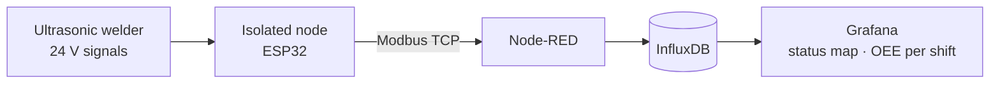

<picture>
  <source media="(prefers-color-scheme: dark)" srcset="assets/banner-dark.svg">
  <source media="(prefers-color-scheme: light)" srcset="assets/banner-light.svg">
  
</picture>

I am a final-year engineering student at **ENSAM Meknès** (GEDI: electromechanical engineering and industrial digitalization, class of 2027). My work follows one thread: taking a signal off a machine and turning it into an indicator someone can act on, through PLCs, industrial networks, data pipelines and dashboards, with a growing focus on OT network security.

> **Open to a 6-month end-of-studies internship (PFE) from February 2027**, in Morocco or abroad: industrial automation, SCADA / IIoT supervision and its security, smart factory, embedded and edge.
>
> [Contact me on LinkedIn](https://www.linkedin.com/in/iliass-kaouachi)

## Selected work

### IIoT supervision for a 125-machine shop floor · Lear Corporation, 2026

A shop of 125 ultrasonic welders had no measurement at all. During my internship in the Maintenance department, I designed its supervision chain end to end, on an air-gapped network.

| | |
|---|---|
| **Latency** | 7.08 s worst case, against a 10 s requirement across the fleet |
| **Validation** | Node tested on a real welder; fleet reproduced with a 122-machine simulator and 18 unit tests |
| **Architecture choice** | LoRa ruled out by calculation: the ETSI EN 300 220 duty cycle allows 36 s polling at best |
| **Data model** | Idempotent absolute counters and a machine state packed into one integer; stored volume divided by 21 |
| **Hardware** | Design note for the node: 5 kV isolation, IEC 60664-1 |

### VCU digital twin · InnovAM'26 (Stellantis × ENSAM Meknès), 1st prize as a team

Electric utility tricycle derived from the Fiat Tris, with team *Atlas Traction* (5 students). **My contribution:** a digital chain linking a Simulink model (longitudinal dynamics, Thevenin battery) to an S7-1200 PLC under PLCSIM over **OPC UA** (KEPServerEX, Prosys), power derating written in **SCL** from route and slope, and indicator monitoring in an **Asset Administration Shell** (AASX).

### Touchless control station: voice, gesture and gaze · ENSAM Meknès, 2026-2027 (ongoing, pair project)

An operator drives a motorized mini-conveyor without touching it. Recognition modules (MediaPipe for gestures and gaze, Vosk for French voice commands) publish intentions over **MQTT**; a fusion engine decides; an **ESP32** state machine drives the motor; **Node-RED** supervises.

- Recognition modules never command the motor: only the fusion engine does.
- Stop always has priority; a critical command needs two modalities within 3 s.
- Safety does not depend on software: hard-wired emergency stop, and the ESP32 stops by itself if the fusion engine goes silent for more than 500 ms.

Status: runs end to end in simulation, with the MQTT contract, fusion logic and firmware state machine covered by automated tests. The project is now oriented toward a research paper on how reliably the three modalities can be fused.

### OT network security · ENSAM Meknès, since September 2026 (ongoing)

- IT / DMZ / OT architecture designed in Packet Tracer (simulation): VLAN segmentation, whitelist rules on a Cisco ASA firewall, VPN. Virtual lab with Kali, pfSense and OpenPLC.
- Node-RED to S7-1500 tests behind a physical SCALANCE S615 firewall (PLC simulated in PLCSIM Advanced): unauthenticated PUT/GET access identified as a risk, tests in progress.

### Also

- **Li-ion battery pack thermal management** (ANSYS Fluent and Mechanical): three cooling architectures compared for 21700 cells under 3C charging, 81 % reduction of the thermal gradient.
- **Multi-protocol interoperability** on ENSAM test benches: Modbus RTU / RS-485, AS-i, PROFIBUS DP and PROFINET brought up to OPC UA, then to MQTT, SQLite and InfluxDB; WinCC Advanced HMI on a KTP700; master/slave Grafcet with a safety Grafcet.
- **Wireless DC motor control** over Zigbee (Arduino Mega 2560).

## Software on this profile

Tools I built to solve a concrete problem on site. Web development is not my field; these show how I take a need from the shop floor to something people can use.

| Repository | What it does |
|---|---|
| [`magasin-management`](https://github.com/K-171/magasin-management) | **INVENTORY**: traceability of R&D tools and assets, built during a one-month internship at the Stellantis Africa Technical Center (2025) and delivered as an online demonstrator. Next.js, PostgreSQL, Prisma. |
| [`ged-project-matcher`](https://github.com/K-171/ged-project-matcher) | **Algorithme du Bonheur**: assigns final-year projects to student teams from their ranked preferences, as an optimal assignment problem. Next.js, Supabase. |

## Toolbox

| | |
|---|---|
| **Automation & supervision** | TIA Portal V16 (S7-1200, SCL, Ladder), PLCSIM, WinCC Advanced, Schneider TSX (PL7 Pro), hierarchical Grafcet |
| **Industrial networks & IIoT** | OPC UA, Modbus RTU/TCP, MQTT, PROFINET, PROFIBUS DP, AS-i, Node-RED, KEPServerEX |
| **Data** | InfluxDB (Flux), Grafana, SQL (PostgreSQL, SQLite), Python, OEE / KPI dashboards, Asset Administration Shell |
| **OT networks & security** | IT / DMZ / OT architecture, VLAN, ACL, VPN, Cisco ASA, SCALANCE S615, pfSense, Wireshark, Nmap; IEC 62443 fundamentals |
| **Embedded & simulation** | ESP32, Arduino, 68HC11 (assembly), KiCad, MATLAB/Simulink, ANSYS Fluent and Mechanical, SolidWorks |

## Certifications & awards

- **1st prize, InnovAM'26** (Stellantis × ENSAM Meknès), with team Atlas Traction
- **Cisco**: Ethical Hacker (2026); Networking Basics, Cybersecurity, Data Science (2024)
- **Ansys Associate Certification**: Foundations of Heat Transfer using Ansys Mechanical (2026)
- **Lean Six Sigma Yellow Belt**, ECLEE (2025)
- Languages: Arabic (native), French (C2, TCF 2026), English (B2)

---

Meknès, Morocco · <a href="https://www.linkedin.com/in/iliass-kaouachi">linkedin.com/in/iliass-kaouachi</a>
